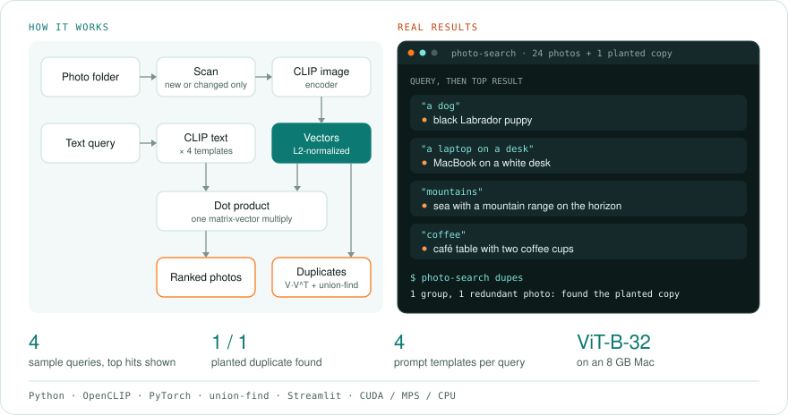
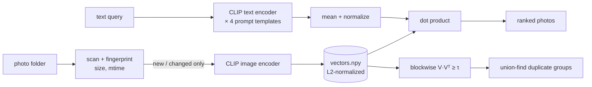

# photo-search

**Google-Photos-style search for your own photo folders, fully offline.** Type "my dog on the beach at sunset" and get the right photos back, with no tags, captions or cloud upload needed. photo-search embeds every image with OpenCLIP, then lets you search by text, by example image, find near-duplicates and auto-tag your library.

  

<!-- author-banner -->
> **Project 04 of 20** in my AI build series, designed and built by **[Abbishekk DGS](https://abbishekkdgs.tech)**. [See all projects →](https://github.com/Abbishekk-DGS)

<!-- overview:start -->
## Overview

<picture>
  <source media="(prefers-color-scheme: dark)" srcset="docs/overview-dark.svg">
  
</picture>

## Interface

You can use it from the terminal or from a gallery app in the browser.

### Terminal

| Command | What it does | Options (default) |
|---|---|---|
| `photo-search index <folder>` | Embeds new or changed photos and drops deleted ones | |
| `photo-search search "<text>"` | Finds photos from a description | `-k` (10) |
| `photo-search similar <image>` | Finds photos like this one | `-k` (10) |
| `photo-search dupes` | Finds near-duplicates | `--threshold` (0.95) |
| `photo-search tag` | Auto-tags with your labels or a built-in list | `--labels`, `--json` |

These go before the command: `--index`, `--model` (default `ViT-B-32`) and `--pretrained`.

### Gallery app

Install it with `uv sync --extra ui`, then start it with `uv run streamlit run src/photo_search/app.py`.

| Area | Controls |
|---|---|
| Sidebar | Folder to index, **Index folder**, number of results (6 to 60), number of columns (3 to 8) |
| Search by text tab | "Describe the photo" box and a photo grid |
| Search by image tab | Upload a photo to find similar ones |
| Duplicates tab | Similarity threshold (0.85 to 0.99), **Find near-duplicates**, grouped results |
<!-- overview:end -->

## Features

- **Text → image search** with CLIP prompt ensembling ("a photo of …", "a picture of …"), which makes queries more robust than a bare phrase
- **Image → image search**: "more like this one"
- **Near-duplicate finder** (bursts, re-saved or resized copies) using blockwise cosine similarity + union-find, so it stays memory-flat on large libraries
- **Zero-shot auto-tagging** with your own label list (receipts, whiteboards, screenshots, pets…)
- **Incremental indexing**: re-running only embeds new or changed files and drops deleted ones
- **Fault tolerant**: one corrupt image doesn't sink the whole batch
- EXIF-aware (rotated phone photos are read upright) · CUDA / Apple Silicon / CPU
- Streamlit gallery UI + CLI

## Results

24 sample photos (picsum.photos) plus one planted duplicate, ViT-B-32 on an 8 GB Apple Silicon Mac:

| Query | Top result |
|---|---|
| "a dog" | black Labrador puppy |
| "a laptop on a desk" | MacBook on a white desk |
| "mountains" | sea with a mountain range on the horizon |
| "coffee" | café table with two coffee cups |
| `dupes` | found the planted copy (1 group, 1 redundant photo) |

## Quickstart

```bash
git clone https://github.com/Abbishekk-DGS/photo-search && cd photo-search
uv sync --extra ui

uv run photo-search index ~/Pictures                     # first run downloads CLIP (~600 MB)
uv run photo-search search "birthday cake with candles"
uv run photo-search similar ~/Pictures/IMG_2041.jpg
uv run photo-search dupes --threshold 0.96
uv run photo-search tag --labels "receipt,whiteboard,screenshot,pet,food"

uv run streamlit run src/photo_search/app.py             # gallery UI
```

Use a bigger model for better accuracy: `--model ViT-L-14 --pretrained laion2b_s32b_b82k`.

## How it works



CLIP was trained on hundreds of millions of image-caption pairs to place matching images and text close together in one vector space. A search is then a single matrix-vector product: 50k photos take milliseconds.

## Development

```bash
uv sync --extra dev
uv run pytest -q    # uses a tiny fake "colour" encoder: no model download needed
```

iPhone HEIC photos work once `pillow-heif` is installed (`uv pip install pillow-heif`); without it they are skipped and reported as failed.

## About the author

Built by **Abbishekk DGS**. More of my work at **[abbishekkdgs.tech](https://abbishekkdgs.tech)** and on **[GitHub](https://github.com/Abbishekk-DGS)**.

## License

MIT © Abbishekk DGS
